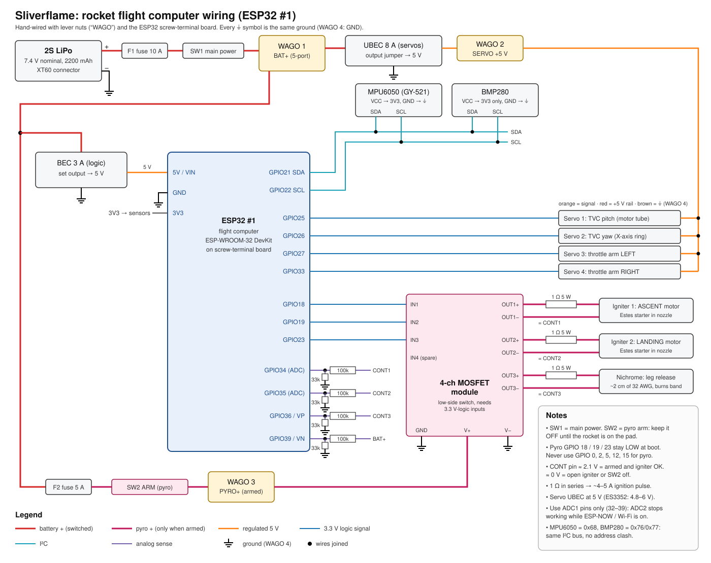
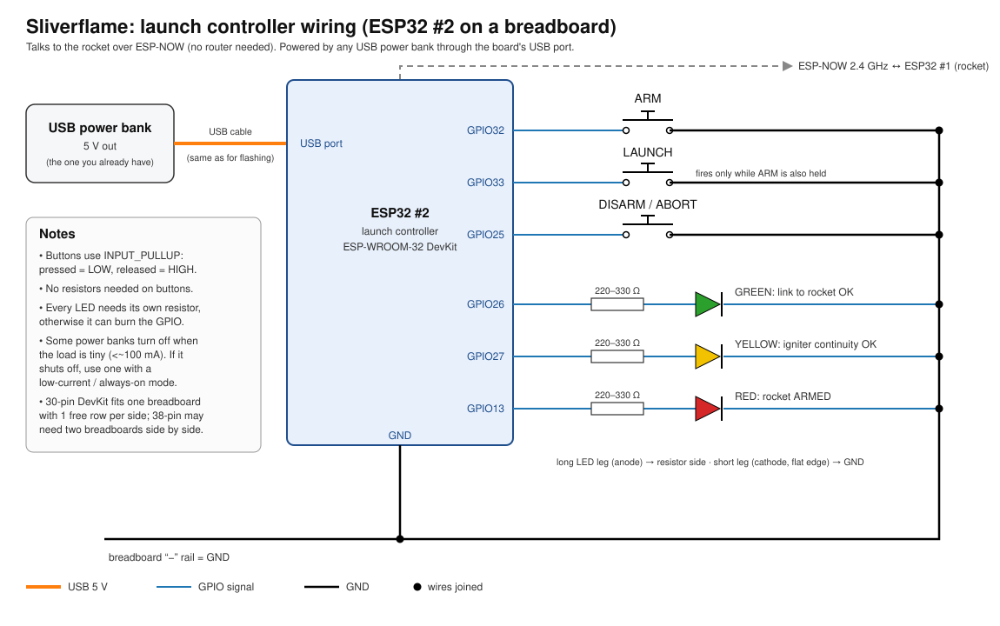

# Sliverflame, Propulsively Landing Model Rocket Using TVC


## What is this?
Sliverflame is an active-stability model rocket designed to achieve vertical, propulsive landings using standard hobby rocket motors. This project is inspired by BPS space, when he landed his model rocket, Scout F. Additionally, I am doing this for stardance(stardance.hackclub.com/).


## How does it work?
1. Dual-Motors config, The rocket engine mount holds two motors sequentially. The upper landing motor is securely housed completely inside the body tube. The lower ascent motor sits partially inserted (~5mm) into the bottom of the tube.
2. Thrust based seperation, Once the ascent motor burns out, the top landing motor is ignited and it pushes the ascent motor in a different direction and then immediately the rocket stabilizes.
3. Throttled landing burn, a solid motor can't be throttled by itself, so two steel paddles under the nozzle redirect part of the exhaust sideways to control how much thrust actually pushes the rocket. See [How the landing motor is throttled](#how-the-landing-motor-is-throttled).

## Progress
I have finished design for all of the parts I just need to also 3D print them and same for landing legs. I am using PETG for the TVC gimbal and for the rest I am using regular PLA.

## Hardware
Look into the files for the parts in this directory or you can check it out in onshape: https://cad.onshape.com/documents/642eb1595bbfbb88e3413de9/w/294c2c178315e1ad00baf07d/e/72f61137f22d9a471da72dad.

Also I didn't go with a PCB because it was like $308 and it is way cheaper to just wire everything physically with wires instead on a PCB. But if you do want to check out the PCB it's in Kicad/ and gerbers.zip in Production/


Here is a shorter BOM list, you can also check out the full one in [BOM.csv](BOM.csv):

| **Item / Category** | **Cost** | **Source** |
| :--- | :--- | :--- |
| **SPARKHOBBY ES3352 Servos** (×4: TVC pitch, TVC yaw, 2× throttle) | $48.28 | Amazon |
| **Custom Laser Cut Throttle Arms** (Steel 1008) | $32.66 | SendCutSend |
| **HOOVO 2S Shorty Lipo Batteries (2-pack)** | $34.43 | Amazon |
| **UHT Carbon Fiber Rods** | $25.69 | Amazon |
| **Avionics & Electronics** (ESP32 2-pack, MPU6050, BMP280, MOSFET module, UBEC + BEC, screw-terminal board) | $86.82 | Amazon |
| **Hardware & Miscellaneous** (Filament, lever connectors, Wires, Fuses, Switches, Resistors, LiPo bag) | $144.02 | Amazon |
| **Structural Consumables** (Nichrome wire, Kraft paper, Rods, Glue, Bands) | $37.45 | Amazon |
| **Total** | **$409.35** | |

Not in the BOM because I already have them: the Estes F15 motors, the LiPo charger, a USB power bank, a breadboard, LEDs and jumper wires.

Changes after review feedback:
- Removed the Estes F15 motor pack and the LiPo charger (I already have both).
- Swapped genuine WAGO 221 lever nuts for a cheaper generic 2/3/5-port lever-connector kit.
- Swapped the 3-pack ESP32-S3 for a 2-pack ESP32 (ESP-WROOM-32): one is the flight computer, the other is the launch controller. The screw-terminal board was swapped to one that fits this ESP32.
- Added the throttle explanation and wiring diagrams below.

## Wiring
Everything is hand-wired (no PCB). Lever connectors are used as power "bus bars": WAGO 1 = BAT+, WAGO 2 = servo +5 V, WAGO 3 = PYRO+ (only live when armed), WAGO 4 = GND.

### ESP32 #1: flight computer (inside the rocket)


**Power path:** 2S LiPo → XT60 → F1 10 A fuse → SW1 main switch → WAGO 1 (BAT+). From there:
- UBEC 8 A (set to 5 V) → WAGO 2 → red wire of all 4 servos.
- BEC 3 A (set to 5 V) → ESP32 `5V/VIN` pin. The ESP32's own regulator makes 3.3 V for the sensors.
- F2 5 A fuse → SW2 ARM switch → WAGO 3 (PYRO+) → MOSFET module `V+` → igniters.

**How the ESP32 ignites a motor:** each igniter (the Estes starter pushed into the motor nozzle) is wired from PYRO+ through a 1 Ω 5 W resistor to one MOSFET output. When the ESP32 sets the pyro pin HIGH (3.3 V), the MOSFET connects the igniter to ground and about 4–5 A flows from the battery through the igniter. Its bridge wire glows, lights the igniter's tip, and that lights the motor. Software holds the pin HIGH for about 1 s, then sets it LOW. This can only happen when **both** SW2 ARM is on (hardware arm) **and** the launch controller has armed the software (software arm). The leg-release nichrome works the same way, but it burns through the rubber band instead.

**Continuity check:** each MOSFET output also goes through a 100 kΩ / 33 kΩ divider to an ADC pin. With SW2 on and a good igniter, the pin reads about 2.1 V. With a broken igniter or SW2 off it reads about 0 V. The sense current is about 0.06 mA, far too small to fire an igniter.

| ESP32 #1 pin | Connects to |
| :--- | :--- |
| `5V / VIN` | BEC 3 A output (5 V) |
| `GND` | WAGO 4 (GND) |
| `3V3` | MPU6050 VCC, BMP280 VCC |
| `GPIO21` / `GPIO22` | I²C SDA / SCL → MPU6050 + BMP280 |
| `GPIO25` | Servo 1: TVC pitch (motor tube) |
| `GPIO26` | Servo 2: TVC yaw (X-axis ring) |
| `GPIO27` | Servo 3: throttle arm left |
| `GPIO33` | Servo 4: throttle arm right |
| `GPIO18` | MOSFET IN1 → ascent motor igniter |
| `GPIO19` | MOSFET IN2 → landing motor igniter |
| `GPIO23` | MOSFET IN3 → landing leg nichrome |
| `GPIO34` / `GPIO35` / `GPIO36` | Continuity sense 1 / 2 / 3 |
| `GPIO39` | Battery voltage (100 kΩ / 33 kΩ from BAT+) |

The pyro pins (18, 19, 23) were picked because they stay LOW while the ESP32 boots. GPIO 0, 2, 5, 12 and 15 can twitch at power-on, so they never drive anything pyro. The analog pins are all on ADC1, because ADC2 stops working while ESP-NOW/Wi-Fi is running.

### ESP32 #2: launch controller (on a breadboard)


A USB power bank plugs straight into the ESP32's USB port, so no extra regulator is needed. It talks to the rocket with ESP-NOW (direct ESP32-to-ESP32 radio, no Wi-Fi router).

| ESP32 #2 pin | Connects to |
| :--- | :--- |
| USB port | USB power bank |
| `GPIO32` | ARM button → GND |
| `GPIO33` | LAUNCH button → GND (only works while ARM is held too) |
| `GPIO25` | DISARM / ABORT button → GND |
| `GPIO26` | 220–330 Ω → green LED (link OK) → GND |
| `GPIO27` | 220–330 Ω → yellow LED (igniter continuity OK) → GND |
| `GPIO13` | 220–330 Ω → red LED (rocket armed) → GND |
| `GND` | breadboard − rail |

Buttons use the ESP32's internal pull-ups (`INPUT_PULLUP`), so a pressed button reads LOW and no resistor is needed.

## How the landing motor is throttled
A solid rocket motor **cannot** be throttled by itself. Once an Estes F15 is lit it burns for about 3.5 s along a fixed thrust curve: a spike of about 25 N right after ignition, then about 15 N average. Sliverflame doesn't change the burn. It changes **how much of the exhaust actually pushes the rocket up**.

**The hardware** ([CAD/Throttle_Arms.step](CAD/Throttle_Arms.step)):
- Two throttle arms laser-cut from 1.5 mm Steel 1008 (steel so the exhaust can't melt them). Each arm is a small lever plate bent 90° into a half-circle paddle.
- When both paddles are closed they make a Ø40 mm disc about 9 mm below the bottom of the motor tube, right in the exhaust.
- Each arm swings on its own pin (Pin5 / Pin6) in a hinge at the bottom of the TVC tube, about 20 mm from the centre.
- Each arm has its own servo, which pushes a spring-steel wire pushrod hooked into a Ø1.6 mm hole on the arm's lever.
- The arms are mounted on the TVC tube, so they tilt together with the gimbal. Steering and throttling don't fight each other.

**Why that reduces thrust:** thrust is the downward momentum of the exhaust leaving the nozzle every second. If a paddle that is bolted to the rocket turns part of the jet 90° sideways, that part of the gas leaves with no downward momentum. The jet pushes down on the paddle as hard as it pushes up on the motor, so that part no longer lifts the rocket. In short:

```
net thrust ≈ motor thrust × (1 − fraction of the exhaust the paddles turn sideways)
```

| Paddle position | What happens | Net thrust |
| :--- | :--- | :--- |
| Fully open (swung out ~90°) | Exhaust passes straight down | ~100 % |
| Partly closed | Paddles catch the outer part of the plume | in between |
| Fully closed (flat disc) | Most of the jet is sprayed out sideways | small fraction |

**When each position is used:**
1. **On the pad and during ascent:** paddles are swung fully open. The ascent motor sticks out of the bottom of the tube right where the paddles close, so they must stay clear of it.
2. **Landing-motor ignition / separation:** still open, so the full thrust kicks the spent ascent motor out.
3. **Landing burn:** a fraction of a second later, once the ascent motor has dropped clear, the paddles close to cut the rest of the ~25 N start spike so the rocket doesn't shoot back up. After that the flight computer sets the paddle angle every loop.

**How the flight computer decides the paddle angle** (every control loop):
1. Estimate height `h` (BMP280 + accelerometer) and downward speed `v`.
2. Work out the braking needed to reach 0 m/s exactly at the ground: `a = v² / (2·h)`.
3. Thrust needed: `T_needed = m · (g + a)`.
4. Thrust available right now, `T_motor(t)`, comes from a lookup table of the F15 thrust curve (time since landing ignition).
5. `throttle = T_needed / T_motor(t)`, clamped between the fully-closed minimum and 1.
6. Convert throttle → servo angle with a calibration table (see below). Both paddles always get the same angle so their side forces cancel.

**Why it's needed (example numbers):** if the rocket weighs about 0.6 kg on landing, its weight is about 5.9 N. The F15 averages about 15 N, so without throttling it would brake at more than 2.5 g, stop in mid-air and climb again. To hover, the paddles have to remove about 60 % of the average thrust, and about 75 % during the 25 N start spike.

**Calibration:** a static test with the TVC tube clamped on a thrust stand (a digital scale works). Fire one motor, sweep the paddle angle during the burn, and log the scale. That gives a real `paddle angle → thrust fraction` table. The real sideways deflection is never a perfect 90°, so measured numbers beat the formula.

## Software
/Production/Software/ for all the software on the rocket. This rocket will be using Arduino IDE to program it. More info will come when I finish the software. My plan for the software is when the computer turns on it goes into a waiting loop and waits until my launch controller(which is also an ESP32) sends a signal to arm the rocket. The rocket then enters in a arm loop. it waits for the launch button to be pressed at the same time as the arm button, once it does it sends ignition to the first rocket motor, and when there is acceleration spike, it changes the variable motor1igntiontrue and then, It enters a Flight Loop. In the Flight loop it will use some math and the IMU gyroscope data, to see if the rocket is about to tilt over, if it is change the TVC orienatation to an opposite of the direction it's falling for a slight bit to get it back to stable, continuing to do those readjustments until the first motor burns out. It check's if the rocket is fine like if it crashed or if something else happened if did it will abort the flight and just fall (not that high). For the landing part is that it will ignite the top motor (landing motor) to push out the ascent motor and the TVC mount to angle one direction for just a bit and then re-stabilize immediately. Final part is just using the TVC loop and once it almost reaches the ground, throttle the motor (or also throttle it at the spike of the burn to prevent the rocket from going up). And finally then deploy landing legs via the nichrome wire and rubber band by burning it and then landing (hopefully).

## Safety Stuff
Since the rocket motor inside the tube can melt the TVC_Tube I am going to add some kraft paper inside so even if the exhaust touches inside the tube it will actually burn the paper and the throttle arms are made from Steel 1008 so I think its good. Additionally, I added software and hardware arming for the rocket motor, and I have to press both the Launch and Arm button to launch, so there is no way for me to accidentantly to ignite it.

- **Hardware arm:** the igniters only get power through SW2 ARM. It stays off until the rocket is on the pad and everyone has stepped back.
- **Software arm:** the launch controller has to arm the rocket, then ARM + LAUNCH have to be held together.
- **Fuses:** 10 A on the main battery line and 5 A on the pyro line.
- **Boot-safe pins:** the pyro outputs use GPIOs that stay LOW while the ESP32 starts up.
- **Continuity check:** the yellow LED on the launch controller shows the igniters are connected before launch.
- LiPos are charged and stored in the fire-retardant LiPo bag.

You can use this project however you'd like.
